# Nexy

Your own AI, on your own devices. Nexy runs models on your computer, or syncs with your **Own 1** so every device in your home can use it.

**[Download the latest release →](../../releases/latest)**

| Device | File | Runs AI itself? |
|---|---|---|
| Mac (Apple silicon) | `Nexy_<version>_darwin-aarch64.dmg` | Yes, with 16 GB of memory or more |
| Windows 10/11 (64-bit) | `Nexy_<version>_windows-x64-setup.exe` | Yes, best with an NVIDIA GPU |
| Android (arm64) | `Nexy_<version>_android-arm64.apk` | No: it uses your Own 1 |
| iPhone | Coming later | No: it will use your Own 1 |

## Do I need an Own 1?

| You have | Without an Own 1 | With an Own 1 |
|---|---|---|
| A Mac or Windows PC | Nexy runs on that computer, with no account. | Every device shares one AI that works 24/7. |
| A phone | Nexy has no AI of its own here. Use a guest code from someone who shares their Own 1. | Your phone becomes a remote for your own AI. |
| A gaming PC as well | It works on its own. | Your Own 1 can send image and chat jobs to its GPU, from any of your devices. |

### Why an Own 1 is the gateway of your private AI cloud

The Own 1 is a small computer that stays on at home. It runs the models and agents, keeps your data, and connects your devices.

- **Always on.** Agents and routines keep working while your laptop sleeps and your phone is off.
- **One brain for every device.** Phones, laptops and tablets use the same models, memory and projects.
- **A gateway, not a cloud.** Your devices reach it over an encrypted private network. Each device has its own key, and nothing joins until you approve it on the Own 1 itself.
- **Uses the hardware you already own.** The Own 1 can hand jobs to a computer that shares its GPU, such as a gaming PC, and returns the result to the device that asked.
- **Nothing to rent.** Prompts and files stay in your home. No account and no subscription are needed for private use.

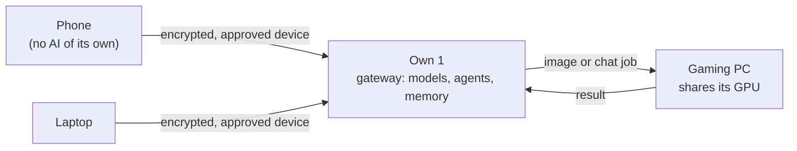

**[Get an Own 1 →](https://checkout.ownx.co)**

## Install

The beta builds are not yet signed by Apple or Microsoft, so your device asks you to confirm the first time.

### Mac
1. Open the `.dmg` and drag **Nexy** to **Applications**.
2. Open Nexy. macOS says *"Nexy" Not Opened: Apple could not verify…*. Click **Done**.
3. Open **System Settings → Privacy & Security**, scroll down to *"Nexy" was blocked*, click **Open Anyway** and enter your password.
4. Nexy opens. You only do this once; updates install from inside the app.

### Windows
1. Run `Nexy_<version>_windows-x64-setup.exe`.
2. If you see "Windows protected your PC", click **More info**, then **Run anyway**.
3. Nexy starts when setup finishes.

### Android
1. Download the `.apk` on your phone and open it.
2. When asked, allow your browser to install apps, then tap **Install**.

## Set up

When Nexy starts, it checks your device and asks where it should run.

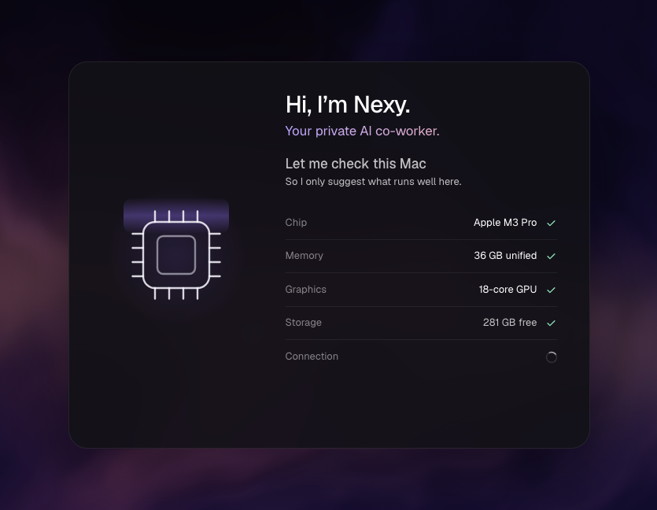

### Option A: run on this computer

Pick **This Mac** (or **This PC**). Nexy suggests a model that fits your memory and downloads it. No account is needed.

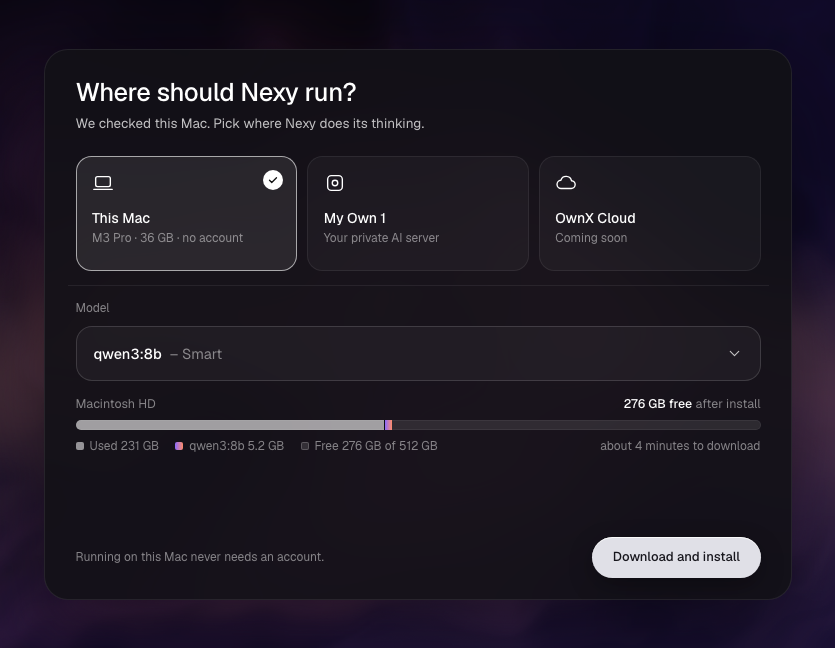

### Option B: sync with your Own 1

1. Pick **My Own 1**, then **Enter sync code**.

   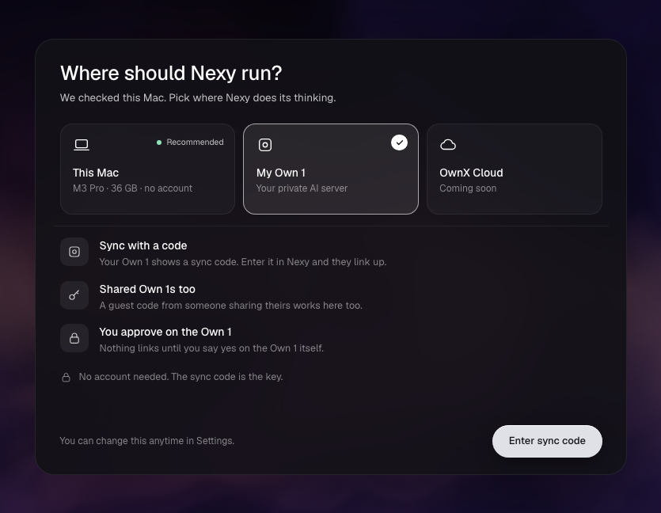

2. On your Own 1, open **Devices → Add device**. It shows an 8-character code for 5 minutes.
3. In Nexy, enter your Own 1's address and the code.

   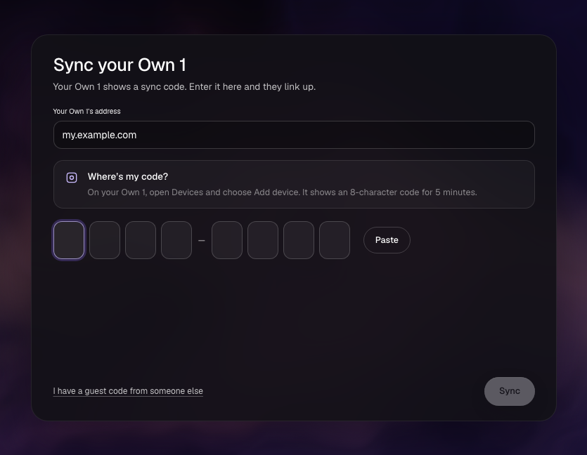

4. Nexy shows a short confirmation code. Check that your Own 1 shows the same code, then approve the device there.

   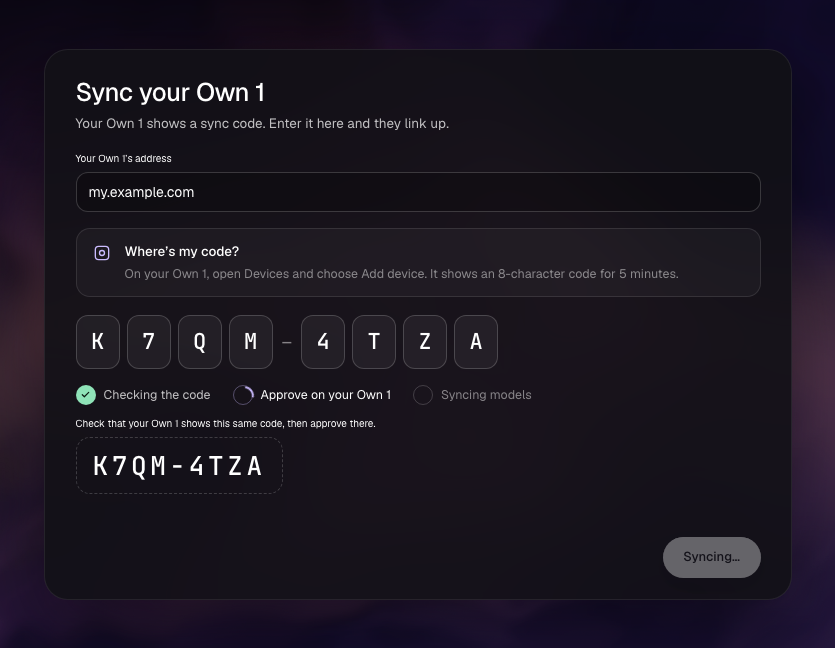

5. Done. Nexy makes a first image on your Own 1 to show it works, and says where it was made.

   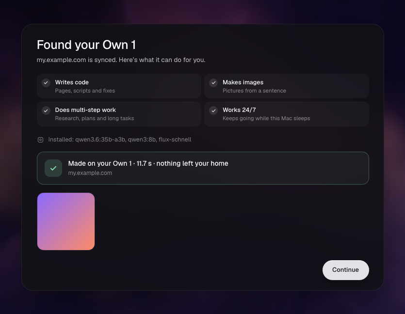

Repeat these steps on each device. Every device gets its own code and its own approval, and you can remove any of them on the Own 1 under **Devices**.

### On a phone

The steps are the same. The phone is the remote: everything runs on your Own 1, or on a computer that shares its GPU with it.

| Where should Nexy run? | Approve on your Own 1 | First image |
|---|---|---|
| 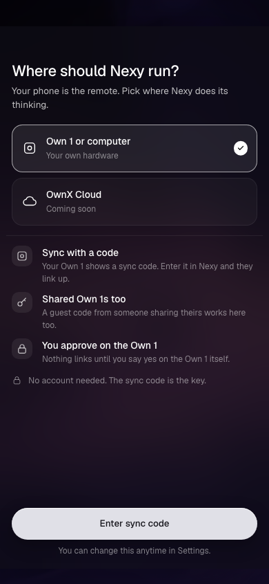 | 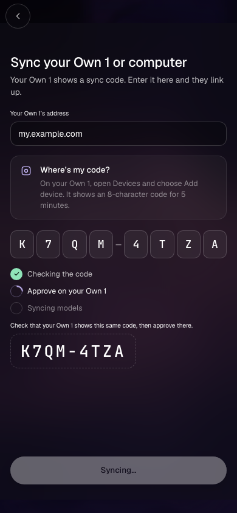 | 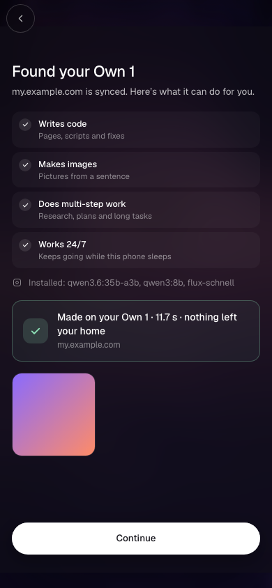 |

### Option C: someone shares their Own 1 with you

Choose **I have a guest code from someone else** and enter their code. Guest access is for AI only, with limits set by the owner. Don't use it for anything confidential: your prompts run on their Own 1.

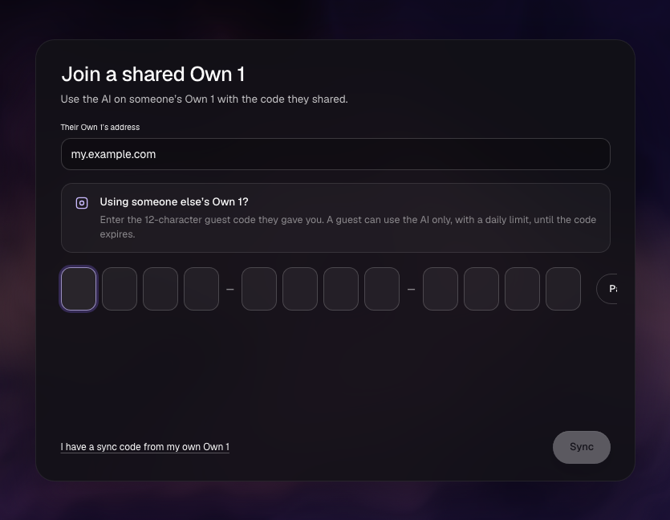

## Share a computer's GPU with your Own 1

On a Mac or Windows PC that is synced with your Own 1, open **Home** and turn on **Share this computer's GPU**. Your Own 1 can then send chat and image jobs to it.

- Images need a local image server. Set its address under **Settings → Model servers → Images**.
- Under **My Own 1 → Run jobs on**, choose where your jobs run: let your Own 1 decide, the Own 1 itself, or one of your devices.
- Each result says where it ran, for example "Made on Gaming PC, through your Own 1".

## Updates

Mac and Android apps check this repository's latest release and offer updates. On Mac the update installs and restarts the app. On Android the system installer opens for you to confirm. Windows updates are coming. Until then, install the new setup file over the old one; your settings are kept.

## Verify your download

- Each release lists the SHA-256 of every file.
- Android: the APK is signed with a certificate whose SHA-256 fingerprint is
  `9B:11:4C:F4:85:4E:0D:18:6D:FA:98:F6:27:12:1D:82:2C:32:FA:F5:A9:FE:BA:C6:A7:A7:25:B3:2B:D5:BA:0A`.
  Check it with `apksigner verify --print-certs <file>.apk`.
- macOS updates: each `.app.tar.gz` has a `.sig` signature, which the app checks against this public key:
  `dW50cnVzdGVkIGNvbW1lbnQ6IG1pbmlzaWduIHB1YmxpYyBrZXk6IEQ0MjcwRUNFNDg4RURGNEQKUldSTjM0NUl6ZzRuMUNkbFJDbXMrS082emtJK0JKVkx0MythdkNzdFdJb1h6NlFuYjZKd0VXVFIK`

Source code is maintained separately.
